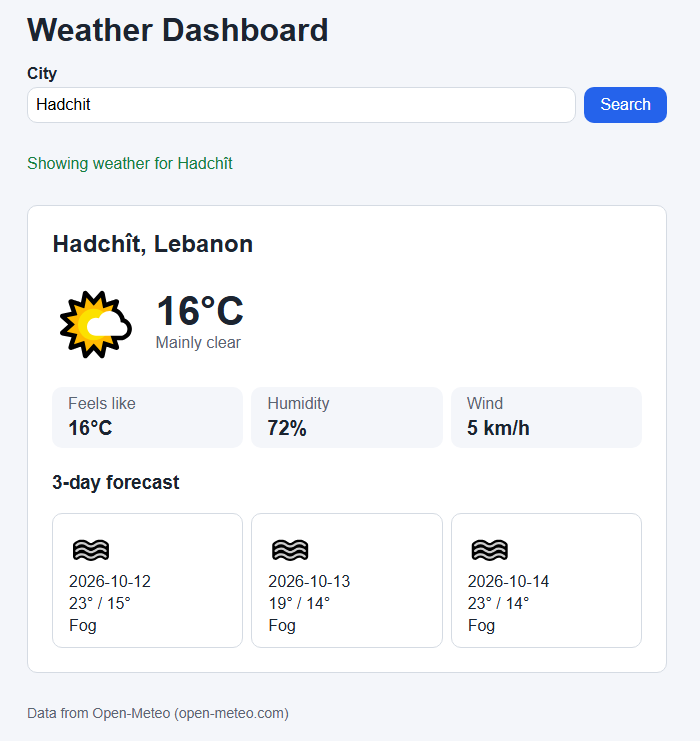

# Weather Dashboard

Type in a city and it shows the current weather there: temperature, conditions, an icon, feels like, humidity and wind, plus a 3 day forecast underneath.

## Running it

Download or clone the repo and open index.html in the browser. Double clicking it works, or you can use Live Server in VS Code. Nothing to install.

## API key

You don't need one. The app uses Open-Meteo (the API from the Session 11 lab), which is free with no sign up and no key. Their docs are at https://open-meteo.com if you want to look at the endpoints.

Since there's no key there's nothing secret in the repo, but .env is still listed in the .gitignore in case the project ever switches to an API that needs a key.

## How it works

Open-Meteo needs coordinates, not a city name, so there are two requests. First the city goes to their geocoding API to get the latitude and longitude, then those go to the forecast API. The forecast comes back as JSON and renderWeather() builds the page from it.

One catch is that Open-Meteo doesn't send a description or an icon, just a number called weather_code. So codes.js has an object that matches each code to some text and an emoji.

## Errors and loading

While it's loading there's a little sliding dot (the loader from the Session 6 slides) and the search button is disabled so you can't spam it.

If something goes wrong you get a message in plain English and a Retry button. Cases covered:
- a city that doesn't exist (try something like "asdfgh")
- searching with an empty box
- being offline (DevTools > Network > Offline)
- bad responses from the API, since fetch doesn't throw on a 404 or 500 by itself. getJSON checks response.ok and throws, and there are separate messages for 429 (too many requests) and server errors.

All the fetching happens inside one try/catch in onSearch() so nothing ends up as an uncaught error in the console.

## Files

- index.html
- style.css
- js/getJSON.js - fetch and the response.ok check
- js/codes.js - weather codes to text and icons
- js/states.js - the idle/loading/success/error states and the error messages
- js/render.js - puts the data on the page
- js/weather.js - the two API calls
- js/main.js - the search form and retry button

The script tags in index.html have to stay in that order because each file uses functions from the ones before it.
